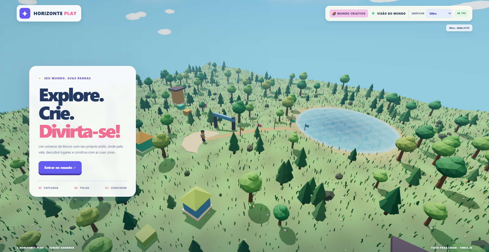

# Horizonte Play 4.8 — Rede multiagente Nina e Alex

**Um jogo sandbox 3D original, explorável no navegador**, construído com [Three.js](https://threejs.org/) e [Vite](https://vite.dev/).



## Recursos

- 🌳 Mundo natural com colinas, árvores, flores, grama animada pelo vento e céu procedural.
- 🧍 Personagem cúbico com câmera em terceira pessoa, caminhada, corrida e salto.
- 🌊 Lago de quase 9 metros de profundidade, com ondas, reflexos simulados e ambiente subaquático.
- 🏊 Natação com postura horizontal, braçadas, pernadas, flutuação e mergulho.
- 🧱 Sistema simples de construção com três cores de blocos e salvamento local.
- 🎮 Perfis gráficos **Equilibrado**, **Alto** e **Ultra**, com contador de FPS.
- 🐟 Peixes, bolhas, plantas subaquáticas, casas e construções decorativas.
- 🧠 **Nina, primeira moradora autônoma:** explora, come, descansa, conversa em português e pode seguir você; inteligência local sem API paga.
- 🏪 **Horizonte Commerce:** construa cafeterias 3D com servidor MCP central, produtos, estoque e pedidos fictícios.
- 💬 **Alex, atendente inteligente:** conversa em português, consulta estoque e prepara pedidos por MCP. Compra só após confirmação do jogador; Gemini textual opcional.
- 🤖 **Alex NPC 3D:** atendente animado em cada cafeteria, com rotina interna, saudações, gestos e reações à presença de Nina.
- 🔗 **Rede multiagente (4.8):** Nina e Alex trocam mensagens nos dois sentidos, consultam estoque real por MCP e concluem demonstrações colaborativas, sem debitar moedas ou alterar estoque. Painel rastreável no jogo e opção de desligar.

## Executar localmente

Pré-requisitos: Node.js compatível com Vite 7 e um navegador com WebGL.

```bash
npm ci
npm run dev
```

Abra o endereço exibido pelo Vite (por padrão, [http://127.0.0.1:5173/](http://127.0.0.1:5173/)). No Windows, também é possível usar o arquivo `INICIAR-3D.bat` após instalar as dependências.

## Controles

| Ação | Controle |
| --- | --- |
| Movimentar-se | W, A, S, D ou setas |
| Girar câmera | Arrastar com o mouse |
| Zoom | Roda do mouse |
| Correr / nadar rápido | Shift |
| Pular / subir na água | Espaço |
| Mergulhar / descer | C ou Ctrl |
| Escolher cor do bloco | 1, 2, 3 |
| Construir bloco | E |
| Desfazer último bloco | Q |
| Pausar | Esc |
| Visão aérea | V |
| Reiniciar posição | R |
| Criar cafeteria | B |
| Atender na cafeteria próxima | G |
| Conversar com Nina (perto dela) | F |

Na conversa, experimente **“me chamo Ana”**, **“o que você está fazendo?”**, **“me siga”** e **“pare de me seguir”**. Nina salva somente seu nome escolhido e alguns metadados locais no navegador.

No lago, o personagem anda pela margem rasa e muda para a animação de natação ao entrar em água suficientemente profunda.

## Desenvolvimento

```bash
npm run test   # testes de terreno, água, construção, gráficos e animação
npm run build  # gera o site estático em dist/
npm run preview
```

### Organização

| Caminho | Responsabilidade |
| --- | --- |
| `src/main.js` | Loop de jogo, câmera, movimentação e interface |
| `src/avatar.js` | Personagem e animações de caminhada e natação |
| `src/world.js` | Cenário, terreno, iluminação e composição |
| `src/visuals.js` | Shaders de céu, água e cáusticas |
| `src/underwater.js` | Animais e vegetação subaquática |
| `src/vegetation.js` | Grama instanciada, vento e árvores |
| `src/terrain.js` | Relevo e profundidade do lago |
| `src/building.js` | Construção e salvamento local |
| `src/graphics.js` | Qualidade gráfica, FPS e pós-processamento |
| `tests/` | Testes automatizados |
| `src/npc.js` | Coordenação da moradora Nina |
| `src/npc-brain.js` | Necessidades, decisões, memória e respostas locais |
| `src/npc-navigation.js` | Navegação em grade A* com obstáculos |
| `src/npc-character.js` | Corpo 3D, animações e identificação do NPC |

Veja também a [especificação do MVP da Nina](docs/NPC-MVP.md).

## Estado do projeto

Versão experimental **4.8**, um jogo local para um jogador. Não há contas, multiplayer, marketplace ou servidor de jogo. A física da água e as colisões são simplificadas. É um projeto original inspirado no gênero sandbox, **sem relação oficial com Roblox**.

**Observação:** o repositório contém apenas o código-fonte, os testes e uma imagem de apresentação. Backups, dependências, builds locais e capturas de teste ficam fora do Git.

## Alex — atendente inteligente, MCP e Gemini opcional (v4.6)

Aproxime-se de uma cafeteria e pressione **G** para conversar com Alex.
O balcão abre na aba **Conversar com Alex**; use **Compra rápida** para o formulário
clássico, mantendo estoque, caixa e demonstração da Nina. As abas aceitam clique e
setas do teclado. A interface foi revisada para desktop e celular.
Peça, por exemplo, **"Quero dois cafés"**. O atendimento consulta produtos pelo MCP
central, apresenta um orçamento e **só registra a compra após clicar em confirmar**.
A opção Gemini para interpretação de texto fica desligada por padrão e **pode gerar custos**.
O modelo textual do atendente é `gemini-2.5-flash`, distinto do modelo Live da Nina.
Sem Gemini, o atendente usa regras locais gratuitas.

Veja [arquitetura, limites, riscos e testes do Atendente Alex](docs/ATENDENTE-IA-MCP.md)
e [plano técnico e critérios do NPC 3D](docs/ATENDENTE-NPC-47.md).

**Rede multiagente 4.8:** Nina vai até uma cafeteria acessível, consulta Alex por
mensagens estruturadas, recebe uma resposta baseada em ferramenta MCP de leitura,
propõe um trabalho em conjunto e os dois concluem uma demonstração de atendimento.
O histórico e o botão de desligar estão no painel **Rede multiagente** à direita.
O diálogo entre NPCs é local e determinístico, sem API paga. Veja
[arquitetura e segurança da rede](docs/MULTIAGENT-NETWORK-48.md).

## Gemini 3.8 Live — recurso opcional (v4.3)

O diálogo local da Nina continua disponível sem internet ou chave. A opção
**Conectar Gemini 3.8 Live** usa conversa em tempo real, voz sintetizada,
transcrição, entrada por texto e microfone (ativado separadamente). Este
recurso **pode gerar custos** na conta Google vinculada à chave. As sessões
são iniciadas apenas com clique e encerradas após, no máximo, 5 minutos.

### Configuração no computador Windows

1. Copie sua **chave de API do Google AI Studio** para a área de transferência.
2. Abra o PowerShell na pasta do projeto e execute:

```powershell
powershell.exe -NoProfile -ExecutionPolicy Bypass -File .\scripts\configure-gemini.ps1
```

O script valida o formato da chave e grava um arquivo criptografado DPAPI
**fora do repositório**, em `%LOCALAPPDATA%\HorizontePlay\gemini-key.dpapi`.
Ele não imprime a chave na tela. Somente o usuário atual do Windows pode
descriptografar esse arquivo. Se a ponte local já estiver executando, ela
é reiniciada para receber a configuração atualizada.

3. Abra o jogo com `INICIAR-3D.bat` (ou seu atalho) e pressione F perto da
Nina; escolha **Conectar Gemini 3.8 Live**. Você pode enviar mensagens
escritas ou clicar **Microfone** para dar permissão de áudio.

### Arquitetura e segurança

- `server/gemini-local.mjs` atende somente `127.0.0.1:4174`.
- A chave de longa duração fica apenas no serviço local, jamais no
  JavaScript do navegador ou no GitHub.
- Uma sessão explicitamente solicitada recebe um token efêmero de uso
  limitado; este token abre a conexão com a API Live do Google.
- Os dados de texto e áudio enviados no modo conectado são processados
  pelo serviço Gemini, sujeito às condições da sua conta Google.
- A UI e o modo local funcionam normalmente se não houver chave.
- A conexão para em `5 minutos`, ao desconectar ou ao fechar o diálogo.
- O servidor local é para desenvolvimento, não deve ser publicado em GitHub Pages;
  uma implantação pública exige um backend autenticado e política de abuso.
- A chave criptografada não entra no repositório; nunca salve chaves em
  `.env` público ou no código fonte.
- Modelos consultados na documentação oficial: `gemini-3.8-live` via
  Gemini Live API. O comportamento real depende de permissões, limites
  e faturamento da chave.

Para desenvolvimento da ponte separadamente:
```powershell
powershell.exe -NoProfile -ExecutionPolicy Bypass -File .\scripts\start-gemini.ps1
```
`GET http://127.0.0.1:4174/health` mostra apenas o estado configurado.

### Chaves novas do Google AI Studio

O configurador reconhece tanto as chaves legadas `AIza...` quanto as chaves
de autenticação modernas `AQ....` (formato lançado pelo Google em 2026).
A chave fica criptografada usando DPAPI no perfil atual do Windows.
O endpoint de provisionamento deste projeto rejeitou o campo
`liveConnectConstraints`; por isso, o token temporário é emitido sem essa
restrição adicional, mas com uso único, início de sessão em até 1 minuto e
expiração em 10 minutos. Este backend é exclusivo para uso local.

**Atenção:** não publique capturas de tela que mostrem chaves API. Caso a
chave apareça em imagem compartilhada, gere uma nova no AI Studio e reconfigure.

## 🏪 Horizonte Commerce 4.4 — Servidor MCP central

Agora é possível criar cafeterias originais com **B**, aproximar-se e
abrir o atendimento com **G**. O painel permite comprar café, pão de queijo
e suco com moedas fictícias, simular um pedido da Nina e repor o estoque.
Lojas, vendas e carteira ficam salvas entre sessões do jogo.

O serviço usa um único servidor **Model Context Protocol** no endereço
`http://127.0.0.1:4180/mcp`, com seis ferramentas verdadeiras para
listar estabelecimentos, consultar estoque, criar cafeteria, registrar
pedido, repor estoque e consultar caixa.

Inicie pelo arquivo `INICIAR-3D.bat`, que liga automaticamente a ponte
Gemini e o servidor Commerce. O serviço não fica acessível na internet.

> O pedido da Nina é uma demonstração acionada pelo jogador; o Gemini Live
> não gerencia o caixa diretamente nesta versão. Não existem transações reais.

Veja [arquitetura, riscos e plano futuro do Horizonte Commerce](docs/COMMERCE-MCP.md).
