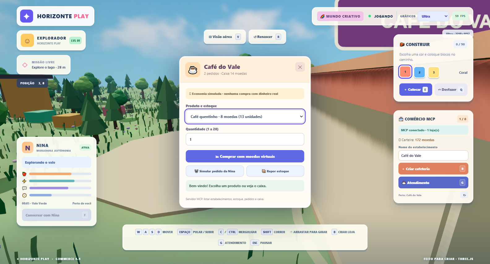
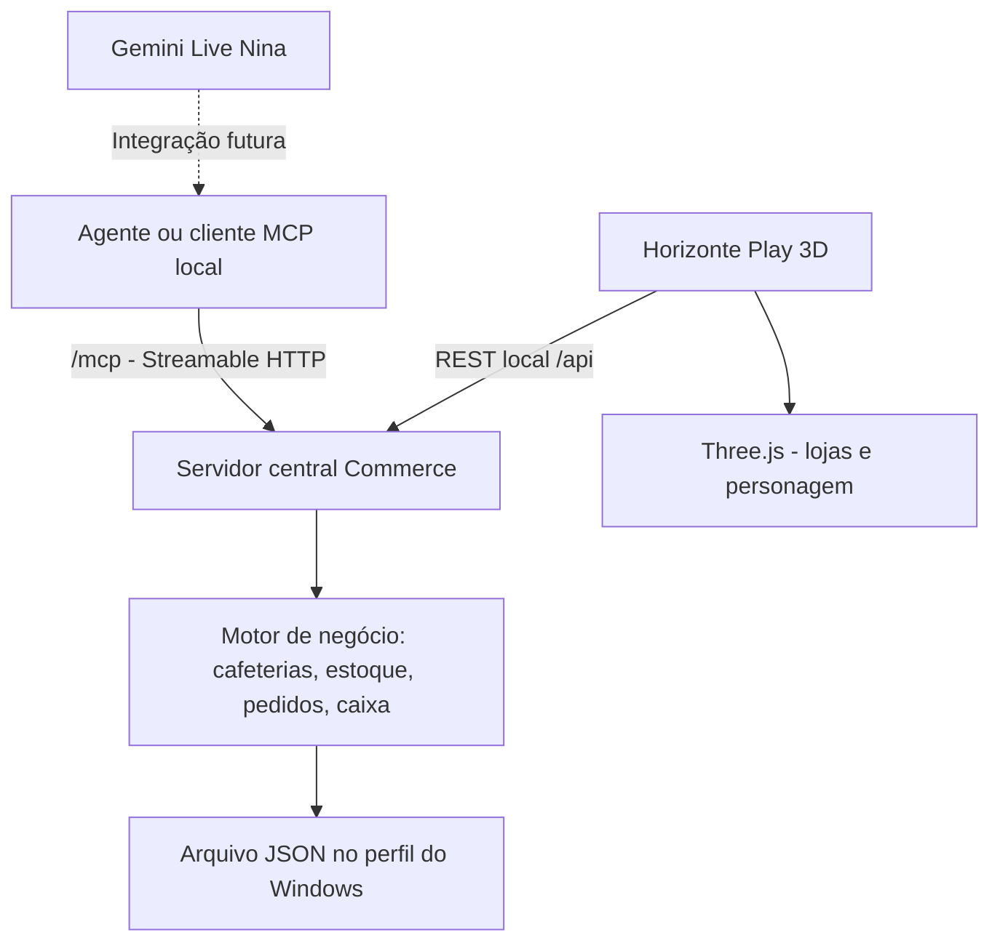

# Horizonte Commerce — MVP 1: Cafeterias e servidor MCP central



## Objetivo e escopo

Transformar construções do Horizonte Play em estabelecimentos que oferecem
serviços digitais via um único servidor MCP central, sem criar um processo
separado por loja ou bloco. O primeiro tipo é uma **cafeteria de balcão**.

### MVP implementado

- Criar até oito cafeterias 3D com tecla **B** ou botão no HUD.
- Buscar posição válida ao redor do personagem sem encostar em árvores,
  casas existentes, água, blocos e outros estabelecimentos.
- Visualizar placa, fachada, toldo, balcão, itens e atendente cenográfico.
- Aproximar-se e pressionar **G** para entrar no atendimento.
- Proteger o nascimento da Nina; se uma loja antiga já ocupar o ponto de spawn,
  ela é reposicionada em terreno transitável sem remover lojas ou vendas.
- Comprar café, pão de queijo ou suco com moedas **100% fictícias**.
- Consultar estoque, visualizar caixa e repor estoque ficticiamente.
- Simular pedido da Nina (cliente) sem gastar as moedas do jogador.
- Salvar lojas, inventário, receita, saldo e pedidos no perfil local do Windows.
- Expor os mesmos dados de negócio por uma API REST local e por ferramentas
  do **protocolo MCP real (Streamable HTTP)**.
- Reiniciar o jogo e restaurar as lojas com seu estoque atualizado.
- Manter gráficos Ultra, construção de blocos, NPC Nina e Gemini Live anteriores.

### Fora deste MVP

- Entrada física em interiores completos, personagens usando móveis,
  entregas com animação e produção automática.
- Nina planejando a própria compra por LLM e chamando ferramentas MCP
  autonomamente. Aqui o pedido de Nina é uma **simulação acionada pelo jogador**.
- Economia compartilhada, múltiplos jogadores, impostos e moedas reais.
- Sistema de profissões, comércio entre NPCs, pagamentos e API bancária.
- Negócios reais, estoques reais, integração com delivery ou POS.
- Hospedagem pública: exige autenticação, autorização, rate limits, auditoria.

## Arquitetura



O serviço central é implementado em `server/commerce-mcp.mjs` com
`@modelcontextprotocol/sdk`, e as regras determinísticas estão em
`server/commerce-domain.mjs`. O cliente 3D usa `src/commerce-client.js`,
`src/commerce-placement.js` e `src/commerce-world.js`.

O sistema economiza GPU: apenas prédios com geometrias simples são
instanciados, e nenhuma nova renderização 3D pesada ocorre no servidor.

## Serviços locais

**Pasta do projeto:** `C:\Users\leo\Documents\Projeto-Base-3D`

Para iniciar o jogo e os serviços, execute `INICIAR-3D.bat`. O script
inicia automaticamente Gemini (porta 4174), Commerce MCP (porta 4180)
e Vite (porta 5173).

Para iniciar somente o servidor Commerce:

```powershell
powershell.exe -NoProfile -ExecutionPolicy Bypass -File .\scripts\start-commerce.ps1
```

Endpoints locais:
- Jogo: `http://127.0.0.1:5173/`
- Saúde do Commerce: `GET http://127.0.0.1:4180/health`
- MCP Streamable HTTP: `http://127.0.0.1:4180/mcp`
- API do jogo: `GET /api/state`, `POST /api/shops`,
  `GET /api/shops/:id/inventory`,
  `POST /api/shops/:id/orders`,
  `POST /api/shops/:id/restock`,
  `GET /api/shops/:id/cash`

### Ferramentas MCP reais

| Ferramenta | Tipo |
| --- | --- |
| `listar_estabelecimentos` | Leitura |
| `consultar_estoque` | Leitura |
| `criar_cafeteria` | Escrita, exige `confirmar: true` |
| `registrar_pedido` | Escrita, exige `confirmar: true` |
| `repor_estoque` | Escrita, exige `confirmar: true` |
| `consultar_caixa` | Leitura |

Cliente MCP local: configure a URL
`http://127.0.0.1:4180/mcp` com transporte **Streamable HTTP**.
O servidor não é um conector do ChatGPT automaticamente; um cliente MCP
precisa se conectar explicitamente. O modo Gemini Live da Nina ainda não
invoca automaticamente essas ferramentas.

## Regras de economia

- Carteira inicial do jogador: **180 moedas fictícias**.
- Café: **8 moedas** (14 unidades iniciais).
- Pão de queijo: **6 moedas** (12 unidades).
- Suco de frutas: **10 moedas** (8 unidades).
- Compras do jogador descontam saldo e estoque.
- Pedidos de demonstração da Nina alteram estoque e caixa da cafeteria,
  mas **não descontam** a carteira do jogador.
- Reposição simulada é gratuita neste MVP.
- Não há cartões, PIX, reais, nem qualquer compra externa.
- Até 8 cafeterias e 20 unidades por pedido.

## Persistência

Arquivo criado pelo servidor no perfil do usuário:

```text
%LOCALAPPDATA%\HorizontePlay\commerce-v1.json
```

A chave de API Gemini existente permanece em arquivo criptografado DPAPI
separado, fora do repositório. O backend Commerce não recebe nem precisa
da chave Gemini.

## Segurança e riscos

- Serviço HTTP ligado somente à interface de loopback `127.0.0.1`.
- Origem do jogo validada para API REST (CORS e checagem de `Origin`).
- Clientes MCP locais podem chamar ferramentas sem autenticação adicional;
  portanto, **não exponha a porta 4180 em rede ou internet**.
- As ferramentas MCP de escrita pedem confirmação em seus argumentos,
  mas isso não é substituto para autenticação em uma implantação pública.
- Nenhum dado de conta bancária ou dinheiro real é armazenado.
- Estoque e carteira são locais e não resistem a compartilhamento simultâneo
  entre máquinas.
- Navegação e colisões ainda são aproximações geométricas.
- Um erro de arquivo ou encerramento inesperado pode causar perda parcial,
  embora os arquivos sejam substituídos via gravação temporária.

## Testes e aceite

Executar `npm run test` e `npm run build`. Testes incluem regras de
inventário e vendas, persistência, restrição por origem HTTP, MCP via
cliente oficial, criação no navegador, pedido da Nina, reposição e restauração
após recarregar.

**Critério fundamental:** o estabelecimento é uma entidade no servidor,
não apenas um objeto decorativo. O serviço MCP é central, real e testável.
