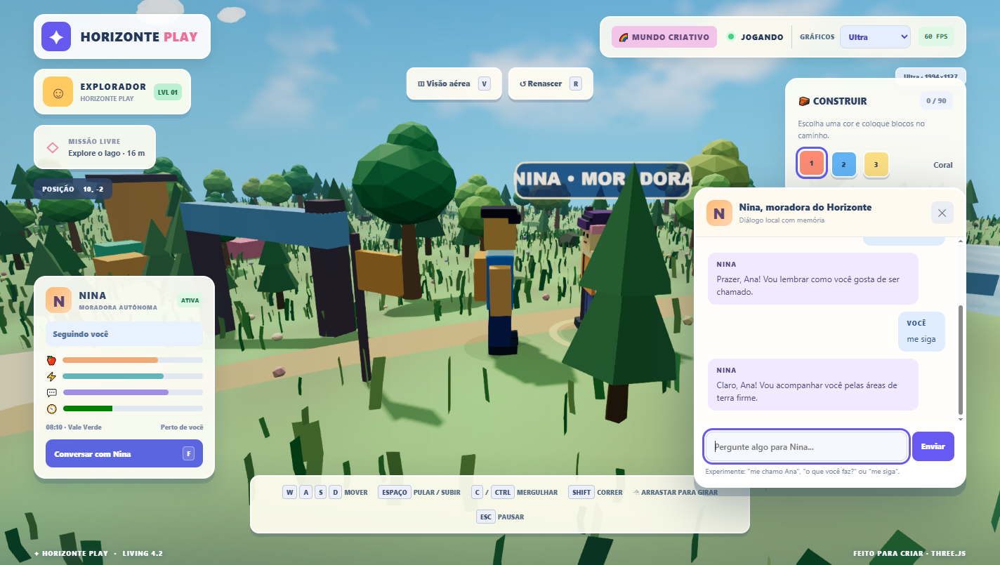

# Horizonte Living — MVP 1: Nina, moradora autônoma



## Objetivo

Introduzir ao Horizonte Play um NPC original que executa uma rotina local,
reage a necessidades simples e conversa com o jogador em português sem depender
de serviços externos.

## Escopo entregue

- Personagem 3D original Nina (roupas laranja, detalhes lilases), com caminhada
  animada, rótulo de identificação e sinal de proximidade.
- Decisão autônoma entre passear, explorar, comer, descansar e socializar.
- Necessidades de saciedade, energia, sociabilidade e curiosidade (0–100).
- Relógio de jogo simplificado e painel de status.
- Navegação A* com desvio de árvores, casas, construções e lago.
- Botão e tecla **F** para conversar quando próximo.
- Diálogo contextual offline em português: nome, necessidades, atividades,
  horários, casas e lago.
- Comandos **"me siga"** e **"pare de me seguir"**.
- Memória mínima e local: nome escolhido, contagem de conversas e último assunto.
- Compatibilidade com movimento, mergulho, construção e presets gráficos atuais.

## Arquitetura

```text
main.js (game loop e UI)
  ├── npc.js               coordenador do personagem
  │   ├── npc-brain.js     regras, objetivos, estado, memória e diálogo (puro)
  │   ├── npc-navigation.js A* e bloqueios de movimento
  │   └── npc-character.js malhas, animação e identificação 3D
  ├── world.js             mapa e obstáculos existentes
  └── building.js          blocos construídos pelo jogador
```

### Lógica e frequência

- A simulação atualiza seu estado no loop do jogo (delta limitado).
- Rotas são recalculadas apenas quando objetivo/obstáculos mudam, ou em
  intervalos (aprox. 1,6s quando acompanha e 6s em atividades fixas).
- O NPC escolhe tarefas com base em necessidades; ao concluir uma tarefa, o
  estado correspondente é recuperado e um novo objetivo é escolhido.
- O personagem permanece terrestre: não entra no lago mesmo se seguir alguém
  que esteja nadando.
- Com a conversa aberta, movimento e decisões do NPC são temporariamente
  interrompidos; o personagem olha para o jogador.

### Diálogo

O diálogo é **determinístico e local**, com respostas predefinidas e memória
de três campos. Não é um chatbot generativo e não utiliza LLM, internet,
contas, servidores, tokens ou chaves de API. Mensagens são inseridas na
interface via `textContent`, não como HTML. O jogo não salva o histórico
completo da conversa. A memória fica em `localStorage` deste navegador,
sob a chave `horizonte-living-nina-v1`.

## Riscos e limitações

- A* em grade e colisões aproximadas não substituem navegação 3D avançada.
- Um único NPC; não existe ainda cooperação entre múltiplos agentes.
- Tarefas de comer e descansar são animadas e refletem mudanças de estado,
  sem inventário, economia ou manipulação de móveis.
- O relógio é acelerado e não representa o tempo real.
- Não há inferência por modelo generativo nem histórico longo de conversas.
- Os dados locais podem ser perdidos se o usuário limpar os dados do site.

## Critérios de aceite

1. O jogo carrega com a Nina visível e movendo-se autonomamente.
2. O NPC não atravessa lago, árvores e paredes aproximadas do mapa.
3. As atividades mudam conforme necessidades e produzem efeitos nos níveis.
4. Com o jogador próximo, a tecla F abre a conversa.
5. Nina lembra o nome informado após recarregar a página.
6. Os comandos seguir/parar alteram o estado do personagem.
7. O jogo anterior (caminhada, mergulho, construção, gráficos) não sofre regressões.
8. `npm run test` e `npm run build` terminam sem falhas.

## Futuro, fora deste MVP

- Diálogos gerados por um modelo de IA com backend seguro e custos controlados.
- Planejamento semântico de ações e memória de longo prazo com consentimento.
- Vários moradores, relações sociais e múltiplos agentes.
- Casas habitáveis, objetos utilizáveis, empregos e economia.
- Replanejamento com navegação dinâmica e melhor colisão.
- Salvamento persistente de necessidades e mundo por usuário.
- Voz/síntese de fala e animação facial.
